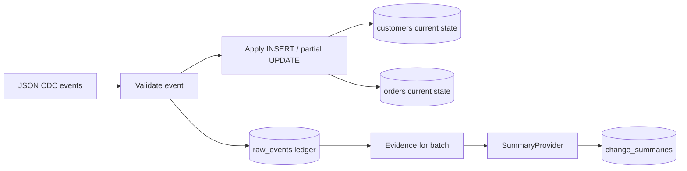

# E-commerce CDC Pipeline (DAI-010)

**Candidate:** Anshika Kumari  
**Track:** Data Engineering  
**Goal:** Incrementally apply customer/order inserts and updates, preserve current state, safely rerun the same batch, and generate a change summary.

## Requirements
- Python 3.10+
- No third-party Python packages required (SQLite is included with Python).
- Optional local AI: [Ollama](https://ollama.com/) and a model such as `llama3.2`.

## Quick start
Run commands from the repository root:

```bash
python run_pipeline.py --show-state
```

The first run creates `cdc_pipeline.db`, loads the synthetic events in `data/changes.json`, and prints counts plus the current customer/order tables.

Run the exact same command again. The same event IDs are skipped; no duplicate customers/orders are created. A new summary run is still recorded in `change_summaries`.

## Tests
```bash
python -m unittest discover -s tests -v
```
Tests cover:
1. Inserts and partial updates preserve the latest state.
2. Replaying an event ID is idempotent.
3. An update for a missing customer fails without recording a raw event.
4. A negative order amount is rejected.

## Add new changes
Append events to `data/changes.json`. Event shape:

```json
{
  "event_id": "evt-007",
  "entity": "customer",
  "operation": "UPDATE",
  "entity_id": "C001",
  "event_time": "2026-10-17T11:00:00Z",
  "data": {"city": "Prayagraj"}
}
```

`entity` must be `customer` or `order`; `operation` must be `INSERT` or `UPDATE`. Customer INSERT needs `name`, `email`, `city`. Order INSERT needs `customer_id`, `amount`, `status`. Partial UPDATEs are supported.

## AI summary interface
The AI component lives in `src/ai_summary.py`. `SummaryProvider` is the interface; `OllamaSummarizer` is an optional local model adapter. The default `RuleBasedSummarizer` is an offline fallback, clearly labelled in output and database. To use a local LLM:
1. Install and start Ollama.
2. Pull a model, e.g. `ollama pull llama3.2`.
3. Set `USE_OLLAMA=1` (PowerShell: `$env:USE_OLLAMA="1"`; macOS/Linux: `export USE_OLLAMA=1`).
4. Run `python run_pipeline.py --show-state` again.

The model receives only the batch's validated event evidence. It is instructed not to invent metrics. No API keys are needed for local Ollama.

## Architecture


See [`sql/schema.sql`](sql/schema.sql) and [`docs/DESIGN_NOTE.md`](docs/DESIGN_NOTE.md).

## Data model
- `raw_events`: event ledger; `event_id` primary key prevents replay duplication.
- `customers`: one current row per customer.
- `orders`: one current row per order, foreign-keyed to customers.
- `change_summaries`: batch summary, count, provider and creation timestamp.

## Assumptions and limitations
- Input events are supplied in valid source order; late/out-of-order update versioning is not implemented.
- This assessment demo simulates CDC using a JSON file; it does not connect to a production database or Kafka.
- SQLite is used to keep clean setup simple.
- See the design note for decisions and future improvements.

## Demo video (5–8 minutes)
Suggested sequence:
1. (0:00–0:45) State the problem and show architecture.
2. (0:45–2:00) Show `data/changes.json` and explain inserts vs partial updates.
3. (2:00–3:15) Run `python run_pipeline.py --show-state`; point out customer city and order status changes.
4. (3:15–4:00) Run it a second time and show `processed: 0`, skipped events, and no duplicates.
5. (4:00–5:30) Run tests and explain the invalid-update / negative-amount edge case.
6. (5:30–6:30) Explain the AI provider interface and optional local Ollama mode.
7. (6:30–7:00) Close with limitations and next steps.

## Submission checklist
- [ ] Push repository to GitHub and verify it is public or accessible to evaluators.
- [ ] Run the project from a clean setup.
- [ ] Run tests and capture terminal output.
- [ ] Record and upload a 5–8 minute demo video; add the link here.
- [ ] Export the one-page design note as PDF if possible.
- [ ] Submit GitHub URL + demo URL + short PDF/README summary.
