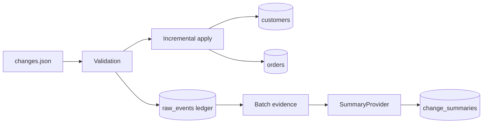

# Design & Decision Note — E-commerce CDC Pipeline
**Candidate:** Anshika Kumari | **Assignment:** DAI-010

## Objective
Process inserts and partial updates for customer/order entities incrementally, preserve a current-state view, make reruns safe, and summarize the evidence from each batch.

## Architecture

## Key decisions
- **SQLite:** zero-service setup and portable local database; suitable for this assessment-sized dataset.
- **JSON event input:** simulates change events from an upstream application/CDC connector. Each event has a stable `event_id`.
- **Idempotency:** `raw_events.event_id` is a primary key. An already-seen event ID is skipped, preventing duplicate application on reruns.
- **Partial updates:** UPDATE payloads merge into the existing current-state row; fields absent from the payload are preserved.
- **Atomicity:** a state change and raw-event insert occur in one transaction. Invalid events are rolled back and not recorded as processed.
- **Referential integrity:** orders require an existing customer. Negative amounts and updates to missing entities are rejected.
- **AI boundary:** `SummaryProvider` isolates summarization from pipeline logic. The project includes an optional local Ollama adapter and an offline deterministic fallback. The fallback is explicitly labelled and does not pretend to be an LLM. Enable Ollama with `USE_OLLAMA=1` after installing/running Ollama and pulling a model.
- **Secrets:** no API keys or credentials are stored in the repository.

## Limitations / next steps
- This is a local batch simulation, not a production CDC connector (e.g. Debezium/Kafka).
- Event ordering is assumed to be supplied correctly by the source; a production version should compare source sequence/version numbers and handle out-of-order updates.
- SQLite is single-node. A production deployment may use PostgreSQL and an orchestrator.
- The local LLM can produce unsupported text; the prompt constrains it to supplied evidence, and the summary is stored with its provider label. Human review is recommended.

## Validation evidence
Run `python -m unittest discover -s tests -v`. Tests cover insert/update current state, duplicate-event idempotency, unknown-customer update rejection, and negative order amount rejection.
